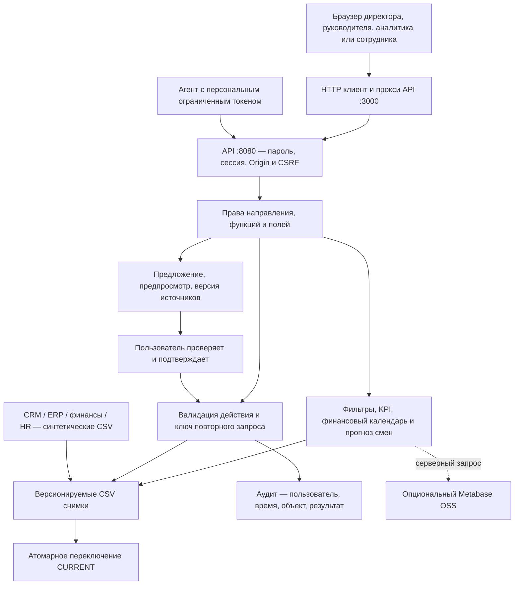

# Архитектура и потоки данных

Локальный MVP трека 1 объединяет реалистичные имитации CRM/поддержки, ERP, финансов и персонала. Идентификаторы customerId, orderId, employeeId, productId и department связывают наборы. Один транспорт Filesystem обслуживает несколько предметных источников.

## Чтение

1. Клиент передаёт фильтры периода, направления, продукта, рынка и региона.
2. API определяет пользователя из серверной сессии и ограничивает направления/поля.
3. Источники читаются из текущего снимка. Метрики используют общую модель дат Europe/Minsk; деньги нормированы в BYN.
4. KPI, разрезы, связанные заказы, сигналы и решения получают согласованный срез. Финансовые планы/факты используют дату финансового события; сверка ERP/1С — когорту заказов.
5. Для каждого источника доступны время обновления, пропуски, дубли и ошибки связей. Неопределённые отношения возвращают null и состояние «Нет данных».

## Запись

Парольный вход создаёт HttpOnly/SameSite сессию. Изменения требуют Origin, CSRF и Idempotency-Key. Перед записью проверяются права, обязательные поля, доступ владельца к направлению, допустимый переход статуса и связи данных. Кандидат кодируется в CSV и повторно декодируется до переключения CURRENT. Ошибка оставляет прежний снимок активным. Действие, аудит и ключ повторного запроса сохраняются вместе.

Формулы агента задаются ограниченным деревом операций, без JavaScript/SQL. Предложение не меняет метрику. Подтверждение доступно только браузерной сессии пользователя; повторно проверяются права существующего и нового определения, версия конфигурации и SHA-256 источников. Версии и откат доступны через API.

## Файлы и процессы

- `client/` — русский интерфейс, темы, доступная клавиатурой навигация, черновики форм.
- `server/api.mjs`, `auth.mjs`, `config-api.mjs` — HTTP-контракт и права.
- `server/analytics.mjs`, `reporting.mjs`, `data-contract.mjs` — формулы, смены, валидация и диагностика.
- `server/filesystem-store.mjs` — один писатель, очередь транзакций, снимки и CURRENT.
- `data/filesystem/` — поставляемые CSV; `.data/filesystem/` — отдельное рабочее хранилище.
- `.data/auth/` — пароли и параметры авторизации, не входят в Git/поставку.
- Metabase подключается только сервером, если настроен; `CONTOUR_BI=off` отключает его для автономной демонстрации.

## Переход к пилоту

Перед подключением реальных данных согласуются владельцы источников, бизнес-формулы, права, сроки хранения, рабочие календари и SLA. Затем добавляются живые адаптеры, SSO, резервное копирование, мониторинг и архивирование снимков. Нагрузочные гарантии и многопроцессная запись в один CSV-каталог в MVP не заявлены.
