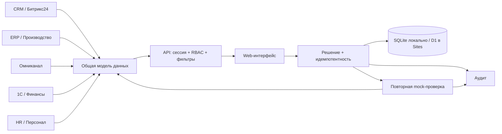

# Фотопринт · Контур

Работающий MVP трека 1: единая управленческая платформа на синтетических данных. Русский адаптивный интерфейс в сдержанном корпоративном стиле, с визуальным ориентиром на SberTech. Основной путь: **сигнал → контекст → причина → владелец и действие → повторная проверка**.

## Запуск за минуту

Требуется **Node.js ≥ 22.13** (проверено на 26.8). Внешние зависимости и `npm install` не нужны.

```sh
cd fotoprint
npm start
```

Открыть **http://localhost:3000**. Порт: `PORT=3001 npm start`. Разработка с перезапуском сервера: `npm run dev`.

База автоматически создаётся в `.data/contour.sqlite`. После остановки и повторного запуска решения, проверки и журнал сохраняются. Пользовательский путь к базе задаётся через `CONTOUR_DB`. Секретов и обязательных переменных окружения нет.

```sh
npm test       # интеграционные проверки API, прав, расчётов и полного сценария
npm run build # самодостаточный Cloudflare Worker для Sites
npm run seed  # перезагрузить демоданные; старый снимок сохраняется рядом как backup JSON
```

## Что реализовано

- **Пульс компании:** 16 вычисляемых KPI, из них 12 на основном экране; план, факт, сценарный прогноз, статус, формула, владелец и время источника.
- **Общие фильтры:** день / 7 / 28 дней, подразделение, продукт. Показатели, график, прогноз, заказы, сигналы и финансовые индексы рассчитываются на сервере по соответствующей выборке.
- **Продажи и клиенты:** динамика, каналы, B2B/B2C, воронка, конверсия, повторные покупки, индекс среднего чека.
- **Производство и качество:** выпуск план/факт, очередь, lead time, простои, брак, ресурс и четыре недели спроса/мощности с первой неделей дефицита.
- **Финансы и люди:** индексы БДР/БДДС, маржа, штат, факт, вакансии, отсутствие; сверка ERP и 1С по идентификатору заказа и статусу оплаты.
- **Сквозной поток:** восемь этапов, поиск, фильтр этапа, пагинация, контекст заказа, ответственный и результаты этапов.
- **Реестр решений:** проблема, влияние, причина, действие, владелец, срок, приоритет, статусы и история. Сервер проверяет переходы. Закрытие возможно после повторной проверки, с сохранением доказательства и целевого порога.
- **Источники:** пять mock-интеграций, свежесть, объём, пропуски/дубли, тест сбоя, восстановление и безопасный повтор.
- **Журнал:** пользователь, время, действие, объект, результат, в том числе ошибки интеграций и отказы в доступе.
- Поиск `⌘K` / `Ctrl+K`, экспорт JSON, доступные с клавиатуры формы, адаптивная навигация.

## Демороли

Роль выбирается в правой части верхней панели. Это **явная демонстрационная авторизация**, без пароля. Возможность переключиться на другую демороль намеренно открыта для жюри. Это не промышленная аутентификация.

| Роль | Доступ |
| --- | --- |
| Руководство | Агрегаты компании, подразделения, решения и проверки; клиентские сведения в детализации ограничены |
| Руководитель фотокниг | Только подразделение `books`, его KPI, заказы, сигналы и решения; прямой запрос чужого подразделения возвращает 403 |
| Аналитик / администратор | Все подразделения, качество данных, управление mock-интеграциями и тестами сбоев |
| Операционная команда | Подразделение `books`, собственные задачи; без финансовых KPI, назначения решений, экспорта и управления источниками |

Права применяются **в API**, а не только скрытием кнопок. Сессия — случайный токен в HttpOnly, SameSite=Strict cookie (Secure на HTTPS), срок 24 часа. Запросы записи с чужим Origin отклоняются.

## Данные и допущения

`src/analytics.mjs` воспроизводимо генерирует **1 800 заказов, 360 клиентов, 800 обращений, 5 продуктов и 3 подразделения**. Источники связаны `customerId`, `orderId`, `productId`, `department` и `sourceEventId`. Отдельные `FP-*` — шесть подробных демонстрационных трасс процесса; они не входят в аналитические итоги. `ORD-*` — строки расчётной витрины. Значения и sparklines рассчитываются из одной выборки, формулы доступны в словаре KPI.

Стартовый пример: 47 фотокниг ожидают проверки. Сигнал объясняет нехватку модераторов и связывается с заказом FP-2847. Успешная mock-проверка переводит часть исходных заказов на следующий этап, оставляя 24 фотокниги в очереди. Это изменение сохраняется, и KPI пересчитываются из обновлённых фактов. Аналогично mock-проверки SLA и доставки меняют связанные исходные записи.

Два ТЗ различаются в отношении финансов: краткая версия запрещает абсолютные суммы, расширенная требует финансовых KPI. Использованы **индексы и доли**: оборот/БДР относительно плана = 100, БДДС — доля оплаченной выручки, себестоимость и маржа в процентах. Внутренние денежные синтетические факты имеют валюту BYN и не передаются в браузер. БДР/БДДС здесь — упрощённые демонстрационные прокси, не полноценный бюджетный учёт.

Прогноз — объяснимый сценарий, не ML: недельный спрос из выбранного периода × (1,06 + 0,12 × номер шага); мощность = доступные часы / 0,8 часа на единицу; на третьей неделе плановое снижение мощности на 10%. Ресурс выбранного продукта распределяется равномерно внутри подразделения. На карточке KPI прогноз количественных метрик равен факту × 1,08, остальных — сохранению текущего уровня. Лиды — пропорциональная периоду и продукту синтетическая CRM-витрина.

Даты хранятся в ISO 8601 UTC; интерфейс показывает локальное время и его часовой пояс в журнале и формах. Данные зафиксированы на момент начальной генерации; `npm run seed` обновляет временную базу и сохраняет резервный снимок. В API есть проверка пустых/невалидных значений, сообщения об ошибках; ошибка сохранения оставляет заполненную форму открытой.

## Архитектура и размещение



`public/` — HTML/CSS/JS без сборочных зависимостей. `src/api.mjs` — общий Fetch API для Node и Worker, `analytics.mjs` — расчёты, `store.mjs` — версия состояния и optimistic compare-and-swap. Запись решения, аудит и ключ идемпотентности фиксируются атомарно одним обновлением SQLite/D1. Конкурентная запись повторяется с проверкой версии. `scripts/build.mjs` встраивает web-ресурсы в Worker; D1 схема — в `drizzle/`. Private Sites deployment использует `.openai/hosting.json`; локальная и размещённая базы независимы.

API: [API.md](API.md). Сценарий показа: [DEMO.md](DEMO.md). Проверки и ограничения: [TESTING.md](TESTING.md).

## Ограничения и путь к пилоту

Все пять интеграций — mock, не реальные подключения. Причины отклонений и исходные гипотезы — явно синтетические, а не автоматически доказанные причинные выводы. Подробные демотрассы FP-* и временные отметки этапов сгенерированы. Индекс здоровья — прозрачный демонстрационный агрегат, не утверждённый бизнес-KPI.

Хранение единого JSON-снимка в SQLite/D1 подходит для демонстрационного объёма; для пилота нужны нормализованные таблицы, миграции данных и индексы, pagination API, ограничение частоты, архивирование журнала и ключей идемпотентности. Сейчас сессии ограничены 1 000 одновременно, а журнал и история проверок не очищаются автоматически. До промышленного запуска заменить демовход на SSO, привязать отдел к подтверждённой учётной записи, подключить API реальных источников, согласовать KPI, бюджетную модель и SLA, добавить мониторинг и резервное копирование. Не размещать здесь реальные данные до этих изменений.

## Внешние ресурсы и лицензии

Нет npm-зависимостей, AI API, заимствованных UI-компонентов или стороннего датасета. SVG-иконки, графики и стили реализованы в проекте. Шрифт **Manrope — SIL Open Font License 1.1**, опционально загружается с Google Fonts; при отсутствии сети используется системный шрифт. Node.js — MIT; встроенный SQLite — public domain. Cloudflare Workers/D1 и Sites — инфраструктурные сервисы по условиям провайдеров. Внешние веб-запросы приложения ограничены опциональной загрузкой шрифта; прикладные данные сторонним AI-сервисам не отправляются.
